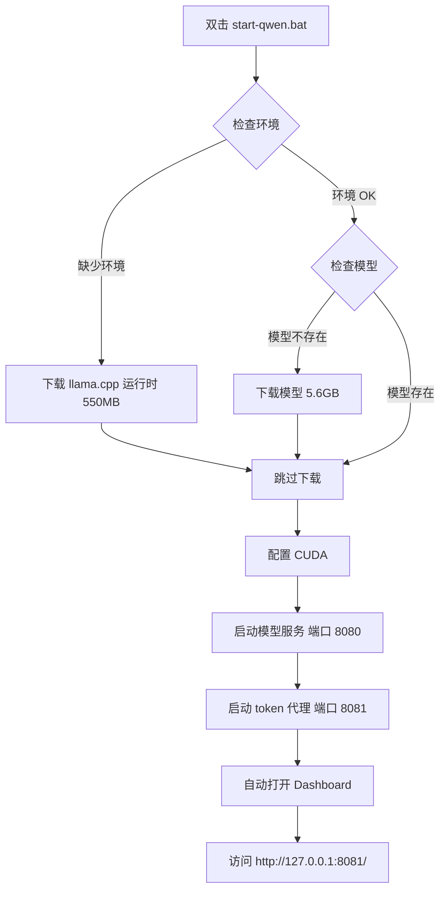

# 🚀 Qwen3.5-9B 128K 快速部署指南

> 5 分钟快速部署，零配置启动

---

## 📝 目录

- [快速开始（3 步）](#快速开始 3 步)
- [首次启动流程](#首次启动流程)
- [启动模式选择](#启动模式选择)
- [常用操作](#常用操作)
- [故障排查](#故障排查)

---

## 快速开始（3 步）

### 步骤 1：克隆仓库

```bash
git clone <your-repo-url>
cd Qwen3.5-9B-128K-oneclick-deepseek-main
```

### 步骤 2：一键启动

**方式 A（推荐新手）**：直接双击

```bash
# 完整版（带视觉）
start-qwen.bat

# 或轻量版（纯文本，更快）
start-qwen-text.bat
```

**方式 B（命令行）**

```powershell
.\qwen-deploy.ps1 -Background
```

### 步骤 3：等待下载完成

首次启动会自动：
- 下载环境（~550MB）
- 下载模型（~5.6GB）
- 配置 CUDA
- 启动服务

**耐心等待，约需 10-15 分钟**。

---

## 首次启动流程



### 启动日志示例

```
[INFO] Checking environment...
[OK] Node.js found: v18.12.0
[OK] PowerShell version: 5.1
[INFO] Downloading runtime...
[Progress] llama-server-windows-cuda-13.4.zip: 100% (550MB)
[INFO] Checking model...
[INFO] Downloading model...
[Progress] Qwen3.5-9B-UD-Q4_K_XL.gguf: 100% (5.6GB)
[INFO] Starting llama-server...
[OK] Model service is listening on port 8080
[INFO] Starting token proxy...
[OK] Token proxy started on port 8081
[INFO] Opening browser...
```

---

## 启动模式选择

| 模式 | 启动时间 | 显存 | 适用场景 |
|------|---------|------|---------|
| **start-qwen.bat** | ~6 分钟 | ~6.5GB | 需要视觉识别 |
| **start-qwen-text.bat** | ~4.5 分钟 | ~5.6GB | 纯文本任务 |

**推荐**：首次使用完整版，后续根据需求选择。

---

## 常用操作

### 停止服务

```bash
# 停止所有服务（推荐）
stop-all.bat

# 或手动停止
taskkill /F /IM llama-server.exe
taskkill /F /IM node.exe
```

### 后台启动

```powershell
# 后台启动（可继续工作）
.\qwen-deploy.ps1 -Background

# 查看状态
.\qwen-deploy.ps1 -Status
```

### 修改上下文窗口

```powershell
# 启动时指定
.\qwen-deploy.ps1 -Ctx 98304

# 或修改脚本第 70 行
.\qwen-deploy.ps1
```

### API 测试

```powershell
# 启动后自动测试
.\qwen-deploy.ps1 -Background -ApiTest
```

---

## 故障排查

### 问题 1：下载卡住

**症状**：超过 15 分钟无进度

**解决**：
```powershell
# 停止服务
taskkill /F /IM llama-server.exe

# 手动下载
Invoke-WebRequest -Uri "https://huggingface.co/unsloth/Qwen3.5-9B-GGUF/resolve/main/Qwen3.5-9B-UD-Q4_K_XL.gguf" -OutFile ".\llama.cpp\models\Qwen3.5-9B-UD-Q4_K_XL.gguf"
```

### 问题 2：启动后立即退出

**症状**：窗口一闪而过

**解决**：
```powershell
# 查看日志
Get-Content .\llama.cpp\logs\server-*.log -Tail 50

# 检查磁盘空间
Get-Volume | Select-Object DriveLetter,FreeSpace
```

### 问题 3：端口被占用

**症状**：`Error: port 8080 is already in use`

**解决**：
```powershell
# 查找占用进程
netstat -ano | findstr :8080

# 杀死进程
taskkill /F /PID <进程 ID>
```

### 问题 4：Dashboard 不更新

**症状**：数字不变化

**解决**：
```powershell
# 检查代理服务
netstat -ano | findstr :8081

# 重启代理
stop-proxy.bat
node traffic-proxy.js
```

---

## 性能优化

### 1. 减少启动时间

```bash
# 使用文本模式
start-qwen-text.bat
```

### 2. 降低显存占用

```powershell
# 使用更小精度
.\qwen-deploy.ps1 -Model 'unsloth/Qwen3.5-9B-GGUF:Q2_K'

# 或减少上下文
.\qwen-deploy.ps1 -Ctx 65536
```

### 3. 提高推理速度

```powershell
# 使用 CUDA 13.4（如果支持）
.\qwen-deploy.ps1 -Cuda cuda-13.4
```

---

## 安全提示

⚠️ **重要**：
- 不要将自定义 API 密钥上传到 GitHub
- 只启用需要的工具
- 不要开放到公网访问

---

## 技术支持

- 查看完整文档：`README.md`
- 更新日志：`.github/RELEASE_NOTES.md`
- 服务日志：`llama.cpp/logs/`
- 统计信息：`traffic-stats/`

---

**版本**: v2.0  
**部署时间**: 首次 10-15 分钟，后续 1 分钟  
**维护者**: Qwen Community
